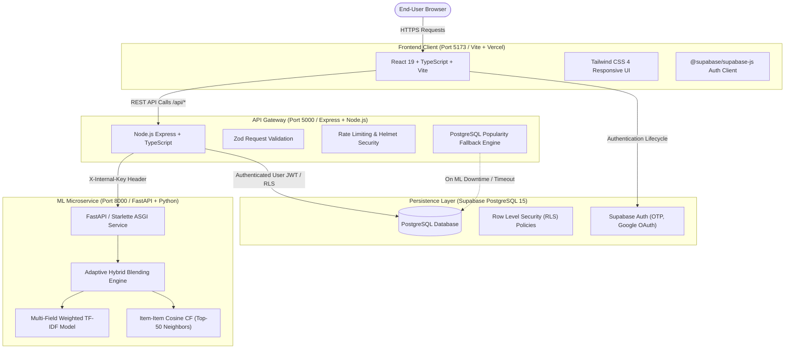

# TalkWise – Personalized TED Talks Recommendation System

> An intelligent, full-stack recommendation engine combining multi-field weighted TF-IDF content modeling, implicit item-item collaborative filtering, and adaptive score blending across 2,550 TED Talks.

[](ml/tests)
[](backend)
[](frontend)
[](ml/service)
[](supabase/migrations)
[-orange?style=flat-square)](LICENSE)

---

## 1. Project Overview & Objectives

**TalkWise** is a standalone, full-stack personalized recommendation system built to help users navigate and discover talks from a curated catalog of **2,550 TED Talks**. Powered by an interaction corpus of **129,557 real-world implicit favorites**, TalkWise addresses common real-world recommender challenges—including new-user cold starts, newly published item cold starts, catalog popularity bias, and low-latency inference.

### Core Objectives
1. **Solve Dual Cold-Start Challenges:** Seamlessly onboard new users via interactive topic curation while routing newly published talks through content similarity scoring.
2. **Adaptive Hybrid Personalization:** Modulate between semantic content features (TF-IDF cosine similarity) and collaborative behavior (item-item co-occurrence) based on the user's interaction maturity.
3. **Sub-2ms Real-Time Fold-In:** Deliver immediate recommendation updates as soon as a user favorites a talk without requiring expensive offline model retraining.
4. **Resilient Three-Tier Architecture:** Provide high availability with an automated PostgreSQL database popularity fallback that ensures zero 500-error screens if the machine learning microservice is unreachable.
5. **Transparency & Trust:** Surface honest, signal-derived explanation badges for every recommendation (e.g., *"Because you favorited 'Do schools kill creativity?' (Topics: education, creativity)"*).

*Note: This repository is an independent student software engineering and machine learning project.*

---

## 2. Key Features

- **Adaptive Hybrid Scoring:** Dynamically weights content similarity versus collaborative filtering according to user interaction depth ($25\%$ collaborative for 1–2 favorites, $50\%$ for 3–4 favorites, and $65\%$ for 5+ favorites).
- **Dual Cold-Start Resilience:**
  - *New User:* Onboarding topic selection immediately seeds a user profile vector before their first favorite.
  - *New Talk:* Talks with zero historical interactions are scored via content features, providing **34.8% catalog coverage** (compared to only 1.7% for popularity baselines).
- **Sub-2ms Fold-In Latency:** Precomputed, truncated top-50 item-item cosine similarity neighbor tables allow instantaneous fold-in of new favorites without retraining.
- **Explainable Recommendations:** Every recommended item displays a human-readable explanation badge detailing which favorited talk and shared topics drove the recommendation.
- **High-Resilience Gateway Fallback:** The Node.js Express API gateway detects ML microservice downtime or timeouts and automatically serves a database-backed popularity fallback with an `is_fallback: true` flag.
- **Dual-Identifier Authentication:** Case-insensitive login supporting either username or email address, 8-digit email OTP verification, password resets, and Google OAuth 2.0 via Supabase Auth and Row Level Security (RLS).
- **Non-Blocking Audit Logging:** "Watch on TED" opens original `ted.com` URLs in a new tab (`rel="noopener noreferrer"`) and dispatches a background `ted_click` audit event without delaying navigation.

---

## 3. Technology Stack

| Layer | Technologies | Purpose |
| :--- | :--- | :--- |
| **Frontend Client** | React 19, TypeScript, Vite, Tailwind CSS v4, Lucide React, `@supabase/supabase-js` | Responsive Single Page Application (SPA), state management, topic onboarding, accessible UI. |
| **API Gateway** | Node.js, Express, TypeScript, Zod, Helmet, `express-rate-limit`, CORS | RESTful API gateway, schema validation, rate limiting, Supabase JWT verification, DB fallback. |
| **ML Microservice** | Python 3.11+, FastAPI / Starlette, Uvicorn, Scikit-learn, SciPy, NumPy, Pandas, Joblib | CSR sparse matrix operations, TF-IDF vectorization, item-item CF, adaptive hybrid scoring. |
| **Persistence & Auth** | PostgreSQL 15 (Supabase), Row Level Security (RLS), Supabase Auth | User profiles, favorite items, interaction audit logs, talk metadata, GIN trigram / text search indexes. |
| **DevOps & Tooling** | Docker (`Dockerfile.backend`, `Dockerfile.ml`), Render, Vercel | Containerized microservice builds, free-tier cloud deployment configurations. |

---

## 4. System Architecture

TalkWise is engineered as a decoupled, three-tier microservice architecture:



---

## 5. Machine Learning & Recommendation Approach

TalkWise blends two complementary recommendation paradigms into an adaptive hybrid model:

```
                          ┌────────────────────────┐
                          │   User Favorites /     │
                          │   Selected Topics      │
                          └──────────┬─────────────┘
                                     │
                 ┌───────────────────┴───────────────────┐
                 ▼                                       ▼
    ┌─────────────────────────┐             ┌─────────────────────────┐
    │   Content-Based Engine  │             │  Collaborative Engine   │
    │  Weighted TF-IDF Model  │             │   Item-Item Cosine CF   │
    │ (Title, Tags, Transcripts)│           │ (129k Favorites Matrix) │
    └────────────┬────────────┘             └────────────┬────────────┘
                 │ Normalized [0, 1]                     │ Normalized [0, 1]
                 └───────────────────┬───────────────────┘
                                     ▼
                        ┌─────────────────────────┐
                        │ Adaptive Hybrid Blender │
                        │  Weight alpha by |F_u|  │
                        └────────────┬────────────┘
                                     ▼
                        ┌─────────────────────────┐
                        │ Ranked Recommendations  │
                        │   + Explanation Badge   │
                        └─────────────────────────┘
```

### 5.1 Multi-Field Weighted Content-Based Model
Content vectors are generated across all 2,550 talks using a custom domain-weighted corpus representation:
- **Field Weights:** `title` (3.0x), `tags` (2.0x), `speaker` (2.0x), `description` (1.5x), `transcript` (1.0x).
- **Vector Space:** Sublinear TF scaling with English stop-word removal and unigram/bigram extraction.
- **User Profile Vector:** For a user $u$ with favorite talk set $F_u$, the profile vector $P_u$ is the normalized centroid of favorited talk vectors:
  $$P_u = \frac{\sum_{t \in F_u} V_t}{\left\| \sum_{t \in F_u} V_t \right\|_2}$$
- **Content Score:** $S_{\text{content}}(u, t) = \cos(P_u, V_t) = P_u \cdot V_t$.

### 5.2 Implicit Item-Item Collaborative Filtering
Trained on 12,401 users and 1,201 talks with 129,557 verified favorite interactions from the Idiap dataset:
- **Item Cosine Similarity:** For items $i$ and $j$ with interaction column vectors $v_i, v_j$:
  $$\text{sim}(i, j) = \frac{v_i \cdot v_j}{\|v_i\|_2 \|v_j\|_2}$$
- **Top-$K$ Truncation:** Each talk retains only its top-50 most similar neighbors ($K=50$), compressing the model into a lightweight 0.35 MB artifact.
- **Instant Fold-In Scoring:** For a user favorite set $F_u$:
  $$S_{\text{collab}}(u, t) = \sum_{f \in F_u} \text{sim}(f, t)$$

### 5.3 Adaptive Score Normalization & Dynamic Blending
Both raw score distributions are normalized via min-max scaling to $[0, 1]$:
$$S_{\text{hybrid}}(u, t) = (1 - \alpha) \cdot \tilde{S}_{\text{content}}(u, t) + \alpha \cdot \tilde{S}_{\text{collab}}(u, t)$$

The weight parameter $\alpha$ dynamically adapts to the user's interaction volume $|F_u|$:
- **$|F_u| = 0$ (New User Cold-Start):** $\alpha = 0.0$ (scored purely against selected onboarding topics).
- **$1 \le |F_u| \le 2$ (Sparse History):** $\alpha = 0.25$ (75% content, 25% collaborative).
- **$3 \le |F_u| \le 4$ (Developing Profile):** $\alpha = 0.50$ (balanced hybrid).
- **$|F_u| \ge 5$ (Mature Profile):** $\alpha = 0.65$ (65% collaborative, 35% content).
- **Item Cold-Start:** If a candidate talk has zero historical interactions in the CF matrix, $\alpha$ is forced to $0.0$ for that talk, guaranteeing complete catalog reach.

---

## 6. Dataset Description & License Attribution

TalkWise combines two academic and open-source datasets to train and evaluate its models:

### 6.1 Dataset Sources
1. **Kaggle TED Talks Dataset (`ted_main.csv` & `transcripts.csv`)**
   - Curated by Rounak Banik from official `ted.com` pages up to September 2017.
   - Contains 2,550 talks with 17 metadata attributes and 2,467 full talk transcripts.
   - **License:** [Creative Commons Attribution-NonCommercial-ShareAlike 4.0 International (CC BY-NC-SA 4.0)](https://creativecommons.org/licenses/by-nc-sa/4.0/).
2. **Idiap TED Recommendation Dataset (`data/TED_dataset/`)**
   - Curated by Nikolaos Pappas and Andrei Popescu-Belis at the Idiap Research Institute, Martigny, Switzerland (published on Zenodo, 2013).
   - Contains 12,605 users, 1,203 talks, and 134,533 user favorite interactions.
   - **License:** [Creative Commons Attribution-NonCommercial-NoDerivs 3.0 Unported (CC BY-NC-ND 3.0)](https://creativecommons.org/licenses/by-nc-nd/3.0/).

### 6.2 Deterministic Talk Matching
Because Idiap talk identifiers use internal hash keys and Kaggle URLs contained minor formatting discrepancies, talks were mapped using a deterministic **canonical URL slug extraction algorithm**:
- **Matching Rate:** **1,201 out of 1,203 Idiap talks (99.83%)** matched cleanly with `ted_main.csv`.
- **Transcript Match:** 100% of matched overlapping talks contain full transcripts.
- **Clean Interactions:** Resulted in 129,557 clean user favorite interactions across 12,401 users.

### 6.3 Academic References & Citations
```bibtex
@inproceedings{pappas2013combining,
  title={Combining semantic content with user preferences for TED lecture recommendation},
  author={Pappas, Nikolaos and Popescu-Belis, Andrei},
  booktitle={2013 11th International Workshop on Content-Based Multimedia Indexing (CBMI)},
  pages={207--212},
  year={2013},
  organization={IEEE}
}

@inproceedings{pappas2013sentiment,
  title={Sentiment analysis of user comments for one-class collaborative filtering over TED talks},
  author={Pappas, Nikolaos and Popescu-Belis, Andrei},
  booktitle={Proceedings of the 36th international ACM SIGIR conference on Research and development in information retrieval},
  pages={817--820},
  year={2013}
}
```

*Legal Notice: This repository is non-commercial and developed strictly for educational and research purposes. All TED video rights, talk audio, and speaker presentation materials belong to TED Conferences, LLC and their respective speakers.*

---

## 7. Project Folder Structure

```
TalkWise/
├── .gitattributes                  # LF line endings enforcement
├── .gitignore                      # Exclusions for .env, node_modules, .venv, caches
├── Dockerfile.backend              # Production multi-stage Express container
├── Dockerfile.ml                   # Production Python FastAPI container
├── render.yaml                     # Render infrastructure blueprint (sync: false for secrets)
├── vercel.json                     # Vercel SPA rewrite & proxy configuration
├── LICENSE                         # Project license
│
├── data/
│   ├── processed/
│   │   ├── talks_clean.csv         # 2,550 deduplicated, cleaned talks
│   │   ├── interactions.csv        # 129,557 clean user favorite interactions
│   │   ├── slug_mapping.json       # Bidirectional slug-to-index mapping
│   │   └── dataset_stats.json      # Preprocessed summary statistics
│   ├── ted_main.csv                # Kaggle TED metadata snapshot (1972-2017)
│   ├── transcripts.csv             # Kaggle TED transcripts
│   └── ted_talks_with_transcripts.csv # Merged feature dataset
│
├── ml/
│   ├── artifacts/                  # Compact precomputed models (< 11 MB total)
│   │   ├── collaborative/          # Item-Item neighbor tables (0.35 MB)
│   │   └── content/                # Sparse TF-IDF matrix & vectorizer (9.6 MB)
│   ├── requirements.txt            # Python dependencies (Pinned)
│   ├── scripts/
│   │   ├── build_dataset.py        # Idempotent ETL cleaning pipeline
│   │   ├── train_collaborative.py  # Item-Item CF neighbor generation
│   │   ├── train_content_and_hybrid.py # TF-IDF feature pipeline
│   │   └── evaluate.py             # Multi-seed ranking evaluation benchmark
│   ├── service/
│   │   ├── main.py                 # FastAPI / Starlette microservice
│   │   ├── loader.py               # Singleton ModelManager loader
│   │   └── schemas.py              # Request/response validation schemas
│   ├── src/talkwise_ml/            # Core Python recommendation package
│   └── tests/                      # 49 unit and integration tests (100% passing)
│
├── backend/                        # Node.js Express REST API Gateway
│   ├── package.json
│   ├── tsconfig.json
│   ├── .env.example                # Template with placeholders
│   └── src/
│       ├── config/                 # Environment validation (Zod)
│       ├── middleware/             # Supabase JWT auth, rate limiters, error handling
│       ├── routes/                 # Talks, recommendations, favorites, activity, auth
│       ├── services/               # Supabase clients & ML client with DB fallback
│       ├── app.ts                  # Express application setup
│       └── index.ts                # HTTP server entrypoint
│
├── frontend/                       # React 19 + Vite + TypeScript Web Application
│   ├── package.json
│   ├── vite.config.ts
│   ├── .env.example                # Template with placeholders
│   └── src/
│       ├── components/             # Navbar, Footer, TalkCard, OnboardingModal, SkeletonCard
│       ├── context/                # AuthContext session management
│       ├── pages/                  # Landing, Dashboard, Browse, TalkDetail, Profile, Auth
│       ├── services/               # Supabase client & Express API client
│       └── types/                  # TypeScript data interfaces
│
├── supabase/
│   └── migrations/                 # PostgreSQL DDL migrations (schema, RLS, triggers)
│
├── scripts/
│   ├── seed_talks.py               # Idempotent talk catalog seeder for Supabase
│   ├── sync_missing_profiles.py    # Profile synchronization utility
│   └── verify_ml_output.py         # End-to-end verification script
│
├── reports/                        # Evaluation reports, benchmark results, and figures
│   ├── figures/
│   │   ├── model_comparison_ndcg.png
│   │   └── precision_recall_tradeoff.png
│   ├── evaluation_report.md        # Detailed evaluation report
│   └── evaluation_results.json     # Raw metrics output from 5-seed benchmark
│
└── README/                         # Engineering documentation references
```

---

## 8. Windows Installation & Setup Instructions

Follow these step-by-step instructions in **Windows PowerShell** to configure and run the project locally.

### 8.1 Prerequisites
- **Git:** Installed and available in your `PATH`.
- **Python:** Version 3.11, 3.12, 3.13, or 3.14 (64-bit).
- **Node.js:** v20.x or newer (v22+ recommended).
- **npm** or **pnpm**.
- **Supabase Account:** A free Supabase project to host PostgreSQL and authentication.

### 8.2 Clone the Repository
```powershell
git clone https://github.com/shivam137421/Ted-Talk-Recommender.git
cd Ted-Talk-Recommender
```

### 8.3 Python Virtual Environment Setup
```powershell
# Create a virtual environment
python -m venv .venv

# Activate the virtual environment
.venv\Scripts\Activate.ps1

# Upgrade pip and install pinned ML dependencies
python -m pip install --upgrade pip
pip install -r ml/requirements.txt
```

### 8.4 Backend API Setup
```powershell
cd backend
npm install
cd ..
```

### 8.5 Frontend Client Setup
```powershell
cd frontend
npm install
cd ..
```

### 8.6 Database Setup (Supabase)
1. In your Supabase dashboard, navigate to the **SQL Editor**.
2. Run the SQL migration scripts in order:
   - `supabase/migrations/20261117000001_initial_schema.sql` (Tables, columns, indexes).
   - `supabase/migrations/20261117000002_rls_policies.sql` (Row Level Security rules).
   - `supabase/migrations/20261117000003_auth_triggers.sql` (Automatic profile creation triggers).
3. Seed the catalog into your Supabase database:
   ```powershell
   .venv\Scripts\Activate.ps1
   $env:SUPABASE_URL="https://your-project.supabase.co"
   $env:SUPABASE_SERVICE_ROLE_KEY="your_supabase_service_role_key_here"
   python scripts/seed_talks.py
   ```

---

## 9. Environment Variable Configuration

Create your `.env` files in `backend/` and `frontend/` using the provided templates. **Never commit `.env` files with real credentials to Git.**

### 9.1 Backend Configuration (`backend/.env`)
Copy `backend/.env.example` to `backend/.env`:
```ini
# Server Configuration
PORT=5000
NODE_ENV=development
FRONTEND_URL=http://localhost:5173

# Supabase Credentials (from Supabase Project Settings -> API)
SUPABASE_URL=https://your-project.supabase.co
SUPABASE_ANON_KEY=your_supabase_anon_key_here
SUPABASE_SERVICE_ROLE_KEY=your_supabase_service_role_key_here

# ML Microservice Communication
ML_SERVICE_URL=http://127.0.0.1:8000
ML_INTERNAL_KEY=your_secure_internal_key_here
```

### 9.2 Frontend Configuration (`frontend/.env`)
Copy `frontend/.env.example` to `frontend/.env`:
```ini
# Supabase Client Configuration
VITE_SUPABASE_URL=https://your-project.supabase.co
VITE_SUPABASE_ANON_KEY=your_supabase_anon_key_here

# Backend REST Gateway URL
VITE_API_URL=http://localhost:5000/api
```

---

## 10. Running the Application

To run the complete TalkWise stack locally, open **three separate Windows PowerShell terminals**:

### Terminal 1: Python ML Microservice (Port 8000)
```powershell
cd Ted-Talk-Recommender
.venv\Scripts\Activate.ps1
$env:PYTHONPATH="ml/src;."
uvicorn ml.service.main:app --host 127.0.0.1 --port 8000 --reload
```
*Health Check:* Open `http://127.0.0.1:8000/health` in your browser. Expected response:
```json
{
  "status": "healthy",
  "service": "talkwise-ml",
  "version": "1.0.0",
  "catalog_size": 2550,
  "models_loaded": true
}
```

### Terminal 2: Node.js Express API Gateway (Port 5000)
```powershell
cd Ted-Talk-Recommender\backend
npm run dev
```
*Health Check:* Open `http://localhost:5000/api/health`. Expected response:
```json
{
  "status": "ok",
  "timestamp": "2026-11-23T18:00:00.000Z",
  "uptime": 12.34
}
```

### Terminal 3: React Vite Frontend (Port 5173)
```powershell
cd Ted-Talk-Recommender\frontend
npm run dev
```
*Access the Web Application:* Open your browser and navigate to **`http://localhost:5173`**.

---

## 11. Testing & Evaluation Benchmark

### 11.1 Running Tests
```powershell
# 1. Run Python ML Unit & Integration Tests (49 tests)
.venv\Scripts\Activate.ps1
python -m unittest discover ml/tests -v

# 2. Run Backend TypeScript Verification
cd backend
npm run build

# 3. Run Frontend Build Verification
cd ../frontend
npm run build
```

### 11.2 Official Multi-Seed Model Evaluation Benchmark
Model performance was evaluated on a verified holdout cohort ($N = 5,656$ users with $\ge 5$ favorites) using a 20% random holdout split executed across **5 fixed random seeds** (42, 43, 44, 45, 46).

To re-run the benchmark evaluation locally:
```powershell
.venv\Scripts\Activate.ps1
python ml/scripts/evaluate.py
```

#### Official Multi-Seed Benchmark Results (Mean $\pm$ Std):

| Model Architecture | Precision@10 | Recall@10 | NDCG@10 | MAP@10 | Catalog Coverage@20 |
| :--- | :---: | :---: | :---: | :---: | :---: |
| **Random Baseline** | $0.0020 \pm 0.0004$ | $0.0047 \pm 0.0018$ | $0.0033 \pm 0.0011$ | $0.0015 \pm 0.0007$ | **99.9%** |
| **Popularity Baseline** | $0.0354 \pm 0.0018$ | $0.1128 \pm 0.0036$ | $0.0884 \pm 0.0050$ | $0.0550 \pm 0.0042$ | 1.7% |
| **Content-Based (TF-IDF)** | $0.0141 \pm 0.0011$ | $0.0542 \pm 0.0056$ | $0.0356 \pm 0.0039$ | $0.0191 \pm 0.0028$ | 37.2% |
| **Collaborative (Item-Item)** | $0.0473 \pm 0.0025$ | $0.1451 \pm 0.0046$ | $0.1121 \pm 0.0062$ | $0.0694 \pm 0.0058$ | 35.3% |
| **Hybrid (TalkWise)** | $\mathbf{0.0483 \pm 0.0029}$ | $\mathbf{0.1490 \pm 0.0066}$ | $\mathbf{0.1156 \pm 0.0077}$ | $\mathbf{0.0717 \pm 0.0068}$ | **34.8%** |

#### Item Cold-Start Experiment (10% Unobserved Items Masked):

| Model Architecture | Precision@10 | Recall@10 | NDCG@10 | Cold-Start Status |
| :--- | :---: | :---: | :---: | :---: |
| **Popularity Baseline** | 0.0000 | 0.0000 | 0.0000 | **Fatal Failure (0%)** |
| **Collaborative Filtering** | 0.0000 | 0.0000 | 0.0000 | **Fatal Failure (0%)** |
| **Content-Based** | **0.0041** | **0.0372** | **0.0179** | **Operational** |
| **Hybrid (TalkWise)** | $\mathbf{0.0041}$ | $\mathbf{0.0372}$ | $\mathbf{0.0179}$ | **Operational (Auto-Fallback)** |

> **Key Evaluation Insights:**
> - The **Hybrid model achieves the highest ranking accuracy** across all metrics ($\text{NDCG@10} = 0.1156$), outperforming Collaborative Filtering (+2.7%) and Popularity (+30.8%).
> - While Popularity achieves reasonable offline accuracy due to head bias, its catalog coverage is an unviable **1.7%** (recommending only the top ~40 items). TalkWise achieves **34.8% catalog coverage**, surfacing hundreds of niche, topic-specific talks.
> - Pure collaborative filtering suffers total failure on newly published talks ($\text{Recall} = 0.0000$). TalkWise's hybrid mechanism automatically detects unobserved talks and routes them through content vectors.

---

## 12. Application Screenshots

| View | Description | Preview |
| :--- | :--- | :---: |
| **Discovery Dashboard** | Personalized recommendation carousels, cold-start topic feeds, and fallback indicators. | *[Screenshot: Dashboard View]* |
| **Talk Detail & Explanation** | Talk metadata, topic tags, external TED link, and dynamic recommendation badge. | *[Screenshot: Talk Detail]* |
| **Topic Onboarding Modal** | Interactive topic selector seeding initial user vectors on first registration. | *[Screenshot: Onboarding Modal]* |
| **Catalog Browse & Filter** | Full-text search, topic filtering, duration filters, and sorting controls. | *[Screenshot: Browse Page]* |
| **User Library & Profile** | Saved favorites, interaction history, and profile management. | *[Screenshot: User Profile]* |

*(To add your local screenshots, place image files inside `docs/screenshots/` and update the markdown links accordingly).*

---

## 13. Limitations & Future Roadmap

### Current Limitations
1. **Historical Catalog Snapshot (1972–2017):** The catalog reflects talks published up to September 2017. View and comment counts reflect the state of TED.com at the time of scraping rather than real-time statistics.
2. **Temporal Interaction Disconnect:** The Idiap user favorites dataset was collected up to September 2012 (1,201 talks). The remaining 1,349 talks published between 2012 and 2017 rely exclusively on content-based scoring.
3. **One-Class Positive Implicit Feedback:** Interactions consist exclusively of favorites (positive signals). Unobserved items indicate unrated or undiscovered talks rather than negative user preference.
4. **Cloud Free-Tier Inactivity Sleep:** Deployments on Render's free tier enter sleep mode after 15 minutes of inactivity, causing an initial 30–50 second wake-up latency. (The Express backend's database fallback gracefully protects the UI during this window).

### Future Roadmap
- [ ] **Live TED Ingestion:** Build an automated RSS / GraphQL scraper to ingest newly released TED Talks and generate TF-IDF vectors on the fly.
- [ ] **Multi-Armed Bandit Exploration:** Incorporate $\epsilon$-greedy or Thompson Sampling algorithms to balance exploitation of known user preferences with exploration of novel topics.
- [ ] **Session-Based Recurrent Models:** Implement sequence-aware session recommendation (e.g., GRU4Rec or SASRec) based on immediate within-session click paths.
- [ ] **Graph Neural Network Embeddings:** Model higher-order user-talk-topic relationships using bipartite graph embeddings (e.g., LightGCN).

---

## 14. Author & Repository Information

- **Author:** **Shivam Yadav**
- **GitHub Profile:** [@shivam137421](https://github.com/shivam137421)
- **Repository URL:** [https://github.com/shivam137421/Ted-Talk-Recommender](https://github.com/shivam137421/Ted-Talk-Recommender)
- **Project Type:** Independent Student Software Engineering & Machine Learning Project
- **License:** Distributed under the [Academic & Research Non-Commercial License](LICENSE).

---
*Developed with precision for intelligent, transparent, and scalable content discovery.*
