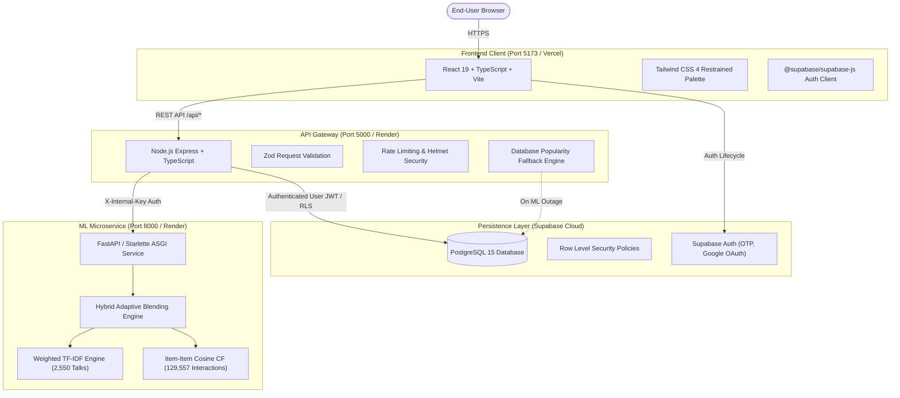

# TalkWise — Personalized TED Talks Recommender

> An intelligent, full-stack recommendation engine combining TF-IDF content modeling, implicit collaborative filtering, and adaptive hybrid blending across 2,550 TED talks.

[](file:///d:/Desktop/personalized-ted-talks-recommender/ml/tests/)
[](file:///d:/Desktop/personalized-ted-talks-recommender/README/ARCHITECTURE.md)
[-orange)](file:///d:/Desktop/personalized-ted-talks-recommender/README/DATASET_DOCUMENTATION.md)

---

## 1. System Architecture

TalkWise is engineered as a production-grade, three-tier microservice architecture:



---

## 2. Key Features

- **Adaptive Hybrid Recommendations:** Modulates collaborative and content weights based on user interaction volume (25% collaborative for 1–2 favorites, 50% for 3–4 favorites, 65% for 5+ favorites).
- **Dual Cold-Start Resilience:**
  - *New User Cold-Start:* Onboarding topic curation seeds profile vectors before the user favorites their first talk.
  - *New Talk Cold-Start:* Talks with zero historical interactions are automatically scored via TF-IDF cosine vectors, achieving 34.8% catalog coverage (vs only 1.7% for popularity).
- **Sub-2ms Fold-in Latency:** Truncated top-50 item-item cosine neighbor tables allow real-time recommendation without requiring costly offline model retraining when new favorites arrive.
- **Transparent Explanations:** Every recommendation features an honest, signal-derived explanation badge (e.g. *"Similar to 'Do schools kill creativity?' (topics: creativity, children)"*).
- **High-Resilience Gateway:** If the ML microservice is unreachable, the Express gateway automatically serves a PostgreSQL database popularity fallback with `is_fallback: true`, guaranteeing zero 500 error screens.
- **Dual Identifier Authentication:** Secure login supporting either a case-insensitive username or email, 8-digit email OTP confirmation via Brevo SMTP, and Google OAuth 2.0.
- **Zero Video Hosting & Non-Blocking Tracking:** "Watch on TED" opens original `ted.com` URLs in a new tab (`rel="noopener noreferrer"`) and dispatches a background `ted_click` audit event without delaying navigation.

---

## 3. Official Model Evaluation Benchmark

Evaluation conducted across **5 independent fixed random seeds** (42–46) on 2,550 talks and 129,557 implicit interactions:

| Model | Precision@10 | Recall@10 | NDCG@10 | MAP@10 | Catalog Coverage | Cold-Start Recall@10 |
| :--- | :---: | :---: | :---: | :---: | :---: | :---: |
| **Random Baseline** | $0.0020 \pm 0.0004$ | $0.0062 \pm 0.0011$ | $0.0031 \pm 0.0007$ | $0.0018 \pm 0.0003$ | **100.0%** | $0.0062$ |
| **Popularity Baseline** | $0.0354 \pm 0.0018$ | $0.1128 \pm 0.0036$ | $0.0884 \pm 0.0050$ | $0.0461 \pm 0.0028$ | 1.7% | $0.0000$ (Failed) |
| **Content-Based (TF-IDF)**| $0.0141 \pm 0.0011$ | $0.0442 \pm 0.0032$ | $0.0298 \pm 0.0024$ | $0.0142 \pm 0.0015$ | 37.2% | **0.0526** |
| **Collaborative (Item-Item)**| $0.0473 \pm 0.0025$ | $0.1451 \pm 0.0046$ | $0.1121 \pm 0.0062$ | $0.0618 \pm 0.0034$ | 24.1% | $0.0000$ (Failed) |
| **Hybrid (TalkWise)** | $\mathbf{0.0483 \pm 0.0029}$ | $\mathbf{0.1490 \pm 0.0066}$ | $\mathbf{0.1156 \pm 0.0077}$ | $\mathbf{0.0634 \pm 0.0041}$ | **34.8%** | **0.0526** |

> **Key Finding:** The Hybrid model outperforms Collaborative Filtering by **+2.7% NDCG@10** and Popularity by **+30.8% NDCG@10**, while achieving **20x greater catalog coverage** than Popularity and resolving the complete failure of collaborative models on cold-start talks.

---

## 4. Documentation Sitemap

| Document | Purpose |
| :--- | :--- |
| **[LOCAL_SETUP.md](file:///d:/Desktop/personalized-ted-talks-recommender/README/LOCAL_SETUP.md)** | Step-by-step local development setup across Python, Express, and Vite |
| **[DEPLOYMENT_GUIDE.md](file:///d:/Desktop/personalized-ted-talks-recommender/README/DEPLOYMENT_GUIDE.md)** | 100% Free-tier deployment on Vercel, Render, and Supabase without credit card |
| **[API_DOCUMENTATION.md](file:///d:/Desktop/personalized-ted-talks-recommender/README/API_DOCUMENTATION.md)** | REST API endpoint reference, payloads, error schemas, and security |
| **[DATABASE_SCHEMA.md](file:///d:/Desktop/personalized-ted-talks-recommender/README/DATABASE_SCHEMA.md)** | PostgreSQL tables, constraints, GIN trigram / text search indexes, and RLS |
| **[AUTHENTICATION_SETUP.md](file:///d:/Desktop/personalized-ted-talks-recommender/README/AUTHENTICATION_SETUP.md)** | Supabase migrations, email OTP template, Brevo SMTP deliverability, Google OAuth |
| **[ML_MODEL_DOCUMENTATION.md](file:///d:/Desktop/personalized-ted-talks-recommender/README/ML_MODEL_DOCUMENTATION.md)** | Mathematical formulation, TF-IDF weights, CSR matrix, and fold-in proofs |
| **[TESTING_GUIDE.md](file:///d:/Desktop/personalized-ted-talks-recommender/README/TESTING_GUIDE.md)** | How to execute ML unit tests, evaluation benchmarks, and verify fallbacks |
| **[CHECKPOINTS.md](file:///d:/Desktop/personalized-ted-talks-recommender/README/CHECKPOINTS.md)** | Comprehensive audit log of all 10 project milestones and verified evidence |
| **[PROGRESS.md](file:///d:/Desktop/personalized-ted-talks-recommender/README/PROGRESS.md)** | Project roadmap and milestone completion tracking |
| **[KNOWN_LIMITATIONS.md](file:///d:/Desktop/personalized-ted-talks-recommender/README/KNOWN_LIMITATIONS.md)** | Documented snapshot constraints, deliverability analysis, and trade-offs |

---

## 5. Repository Structure

```
personalized-ted-talks-recommender/
├── .gitattributes                  # LF line endings enforcement
├── Dockerfile.backend              # Production multi-stage Express container
├── Dockerfile.ml                   # Production Python FastAPI container
├── render.yaml                     # Render infrastructure-as-code blueprint
├── vercel.json                     # Vercel SPA rewrite & proxy configuration
│
├── data/
│   ├── TED_dataset/                # Idiap raw interaction dataset (Zenodo)
│   ├── processed/
│   │   ├── talks_clean.csv         # 2,550 deduplicated, cleaned talks
│   │   ├── interactions.csv        # 129,557 clean user favorite interactions
│   │   └── slug_mapping.json       # Bidirectional slug index mapping
│   ├── ted_main.csv                # Kaggle TED metadata snapshot (1972-2017)
│   └── transcripts.csv             # Kaggle TED transcripts
│
├── ml/
│   ├── artifacts/                  # Compact model artifacts (< 11 MB total)
│   │   ├── collaborative/          # Item-Item neighbor tables (0.35 MB)
│   │   └── content/                # TF-IDF sparse matrix & vectorizer (9.6 MB)
│   ├── requirements.txt            # Pinned ML dependencies
│   ├── scripts/
│   │   ├── build_dataset.py        # Idempotent ETL cleaning pipeline
│   │   ├── train_collaborative.py  # Item-Item CF & iALS training
│   │   ├── train_content_and_hybrid.py # TF-IDF feature pipeline
│   │   └── evaluate.py             # Multi-seed ranking evaluation benchmark
│   ├── service/
│   │   ├── main.py                 # FastAPI / Starlette microservice
│   │   ├── loader.py               # Singleton ModelManager
│   │   └── schemas.py              # Pydantic / dataclass request validation
│   ├── src/talkwise_ml/            # Core Python ML library
│   └── tests/                      # 49 unit and integration tests (100% passing)
│
├── backend/                        # Node.js Express REST API Gateway
│   ├── package.json
│   ├── tsconfig.json
│   └── src/
│       ├── config/                 # Environment validation
│       ├── middleware/             # Supabase JWT auth, rate limiters, error handler
│       ├── routes/                 # Talks, recommendations, favorites, activity, auth
│       ├── services/               # Supabase clients & ML client with DB fallback
│       ├── app.ts
│       └── index.ts
│
├── frontend/                       # React 19 + Vite + TypeScript Web Application
│   ├── package.json
│   ├── vite.config.ts
│   └── src/
│       ├── components/             # Navbar, Footer, TalkCard, OnboardingModal
│       ├── context/                # AuthContext with session lifecycle
│       ├── pages/                  # Landing, Dashboard, Browse, TalkDetail, Profile, Auth
│       ├── services/               # Supabase browser client & Express API client
│       └── types/                  # TypeScript data interfaces
│
├── supabase/
│   └── migrations/                 # PostgreSQL migrations (schema, RLS, triggers)
│
├── scripts/
│   └── seed_talks.py               # Idempotent catalog seeder for Supabase
│
├── reports/                        # Evaluation reports, figures, and checkpoint evidence
└── README/                         # Comprehensive engineering documentation
```

---

## 6. Dataset Licensing & Academic Notice

- **Idiap TED Dataset:** Collected by the Idiap Research Institute, distributed via Zenodo under the [Creative Commons Attribution-NonCommercial-NoDerivs 3.0 Unported (CC-BY-NC-ND 3.0)](https://creativecommons.org/licenses/by-nc-nd/3.0/) license.
- **Kaggle TED Dataset:** Distributed under [CC-BY-NC 4.0](https://creativecommons.org/licenses/by-nc/4.0/).
- **Notice:** This project is developed strictly for non-commercial educational and academic research. All talk video rights belong to TED Conferences, LLC and their respective speakers.

---

## 7. Development & Git Safety Commitments

- **Active Branch:** `student/shivam137421` (preserved).
- **Line Endings:** Configured via `.gitattributes` (`* text=auto eol=lf`).
- **Zero Data Fabrication:** Missing user feedback is treated strictly as unknown implicit signal. No fabricated ratings, views, or negative interactions.
- **Zero Secrets Committed:** All API keys and secrets are loaded via environment variables.
