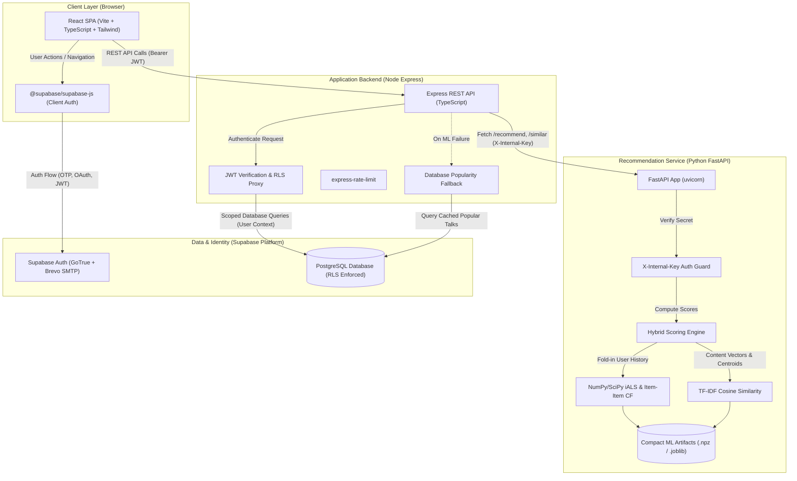

# System Architecture: TalkWise

This document details the architectural layout, component interactions, and data flows of TalkWise.

---

## 1. System Topology & Component Diagram



---

## 2. Component Breakdown

### 2.1 Frontend Layer (`/frontend`)
- **Technology:** React 19 / Vite / TypeScript / Tailwind CSS / React Router.
- **State Management:** Lightweight React Contexts (`AuthContext`, `ToastContext`).
- **Auth Management:** Browser-safe `@supabase/supabase-js` using publishable key (`sb_publishable_...`).
- **Design Tokens:** Warm off-white background (`#FAF8F5`), charcoal text (`#1A1A1A`), TED-toned red accent (`#C8102E`), light grey borders (`#E5E2DC`), 4–6px border radii.

### 2.2 Backend Gateway (`/backend`)
- **Technology:** Express / TypeScript / Zod / Helmet / Morgan / Express-Rate-Limit.
- **Role:** Central application gateway orchestrating talk queries, user activity tracking, favorite toggling, profile resolution, and proxying recommendations.
- **Security:** Verifies Supabase Bearer JWT tokens. Passes user token to Supabase client so PostgreSQL Row Level Security (RLS) policies are respected.
- **Failover:** In the event that the Python ML service is starting up, cold-booting, or temporarily unavailable, Express gracefully catches the HTTP error and returns top popular and diverse talks from PostgreSQL, flagging `source: "popularity_fallback"`.

### 2.3 ML Recommendation Microservice (`/ml/service`)
- **Technology:** Python 3.13 / FastAPI / Uvicorn / Pydantic / NumPy / SciPy / Scikit-Learn.
- **Role:** Pure stateless recommendation engine.
- **Endpoints:**
  - `GET /health`: Healthcheck, uptime, loaded model versions.
  - `POST /recommend`: Accepts user favorited slugs, optional topic preferences, and generates top-$K$ recommendations with honest explanations.
  - `GET /similar/{slug}`: Returns top content and collaborative neighbors for a specific talk.
  - `GET /popular`: Returns global baseline talk rankings.
- **Security:** Requires `X-Internal-Key` header matching the backend secret.

### 2.4 Persistence & Identity Layer (Supabase)
- **PostgreSQL 15+:** Hosts relational schema with RLS on all user tables.
- **GoTrue Auth:** Handles sign-ups, email OTP verification via Brevo SMTP, password resets, and Google OAuth.
- **Triggers:** Automatically initializes user profiles on auth user creation.

---

## 3. Core Data Flows

### 3.1 Recommendation Generation Flow
```
User navigates to Dashboard
       │
       ▼
Frontend requests GET /api/recommendations (Authorization: Bearer <jwt>)
       │
       ▼
Express validates JWT and extracts user_id
       │
       ├─► Queries Supabase: Fetch user's favorited talk slugs & onboarding preferences
       │
       ▼
Express calls ML Service: POST /recommend (X-Internal-Key: <secret>)
       │  Body: { favorite_slugs: [...], preferred_tags: [...], k: 10 }
       │
       ▼
FastAPI computes hybrid scores:
       ├─► Item-Item CF & iALS fold-in on favorite slugs
       ├─► TF-IDF user profile vector & cosine similarity
       ├─► Adaptive weighted score blend with cold-start fallback
       ▼
Returns ranked slugs with explanations to Express
       │
       ▼
Express hydrates talk slugs with full metadata from database
       │
       ▼
Returns rich recommendation payload to Frontend with source: "personalized"
```

