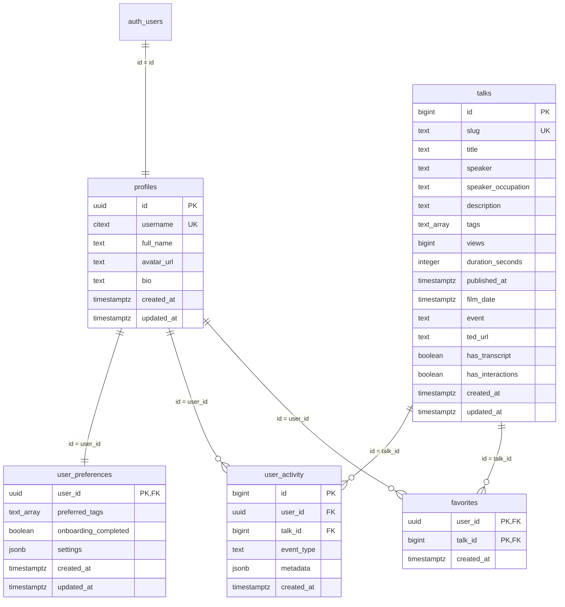

# TalkWise Database Schema Documentation

## 1. Overview & Architecture
TalkWise uses **PostgreSQL 15+** hosted on **Supabase**. The database acts as the single source of truth for the entire application catalog, user accounts, preferences, interaction history, and audit logs.

### Principles:
1. **Catalog Single Source of Truth:** The `talks` table stores all canonical metadata (title, speaker, description, tags, views, duration, URLs). ML models store *only* mathematical vectors, latent factor matrices, and slug mappings—never duplicated metadata.
2. **Row Level Security (RLS) Everywhere:** Every single table has RLS enabled. Anonymous and authenticated clients can only perform actions explicitly granted by policy.
3. **No Direct Secret Exposure:** Client browsers only access Supabase using the public anonymous publishable key (`sb_publishable_...`). Privileged service operations (such as username-to-email resolution and catalog seeding) use the server-side service role key exclusively within Express or CLI scripts.
4. **Resilient Keying:** The canonical identifier across all systems (CSV, JSON, ML artifacts, DB, Express, React) is the normalized URL `slug` (`/talks/<slug>`). The `talks` table also includes a surrogate `id BIGINT GENERATED ALWAYS AS IDENTITY` for efficient foreign key indexing.

---

## 2. Extensions

| Extension | Version / Scope | Purpose |
| :--- | :--- | :--- |
| `citext` | `public` | Case-insensitive character string type used for `profiles.username` to enforce unique case-insensitive handles without `LOWER()` indexes. |
| `pg_trgm` | `public` | Trigram matching used for GIN indexes on `title` and `speaker` to support fast fuzzy substring searching and autocomplete. |

---

## 3. Entity-Relationship Diagram

---

## 4. Tables and Constraints

### 4.1. `public.profiles`
Stores user profile information, linked 1-to-1 with Supabase `auth.users`.
- `id UUID PRIMARY KEY REFERENCES auth.users(id) ON DELETE CASCADE`
- `username CITEXT UNIQUE NOT NULL`
  - Constraint: `CHECK (username ~ '^[a-z0-9_]{3,30}$')` (enforces 3–30 lowercase alphanumeric and underscore characters).
- `full_name TEXT`
- `avatar_url TEXT`
- `bio TEXT`
- `created_at TIMESTAMPTZ NOT NULL DEFAULT NOW()`
- `updated_at TIMESTAMPTZ NOT NULL DEFAULT NOW()`

**Indexes:**
- `idx_profiles_username`: B-tree on `username`.

### 4.2. `public.talks`
The authoritative catalog of 2,550 TED talks.
- `id BIGINT GENERATED ALWAYS AS IDENTITY PRIMARY KEY`
- `slug TEXT UNIQUE NOT NULL` (e.g. `ken_robinson_says_schools_kill_creativity`)
- `title TEXT NOT NULL`
- `speaker TEXT NOT NULL`
- `speaker_occupation TEXT`
- `description TEXT NOT NULL`
- `tags TEXT[] NOT NULL DEFAULT '{}'`
- `views BIGINT NOT NULL DEFAULT 0` (snapshot count from dataset creation)
- `duration_seconds INTEGER NOT NULL DEFAULT 0`
- `published_at TIMESTAMPTZ`
- `film_date TIMESTAMPTZ`
- `event TEXT`
- `ted_url TEXT NOT NULL`
- `has_transcript BOOLEAN NOT NULL DEFAULT FALSE`
- `has_interactions BOOLEAN NOT NULL DEFAULT FALSE`
- `created_at TIMESTAMPTZ NOT NULL DEFAULT NOW()`
- `updated_at TIMESTAMPTZ NOT NULL DEFAULT NOW()`

**Indexes:**
- `idx_talks_slug`: B-tree unique index on `slug`.
- `idx_talks_views`: B-tree index on `views DESC` (powers the popularity fallback and most-viewed sorting).
- `idx_talks_published_at`: B-tree index on `published_at DESC NULLS LAST` (powers recently-added feeds).
- `idx_talks_tags`: GIN index on `tags` (`USING GIN(tags)`), enabling fast array containment queries (`tags @> ARRAY['technology']`).
- `idx_talks_title_trgm`: GIN trigram index on `title` (`USING GIN(title gin_trgm_ops)`).
- `idx_talks_speaker_trgm`: GIN trigram index on `speaker` (`USING GIN(speaker gin_trgm_ops)`).
- `idx_talks_search`: Full-text GIN search index on `to_tsvector('english', title || ' ' || speaker || ' ' || COALESCE(description, ''))`.

### 4.3. `public.favorites`
Implicit/explicit positive feedback signal. Serves as user history for collaborative and hybrid recommendations.
- `user_id UUID NOT NULL REFERENCES public.profiles(id) ON DELETE CASCADE`
- `talk_id BIGINT NOT NULL REFERENCES public.talks(id) ON DELETE CASCADE`
- `created_at TIMESTAMPTZ NOT NULL DEFAULT NOW()`
- `PRIMARY KEY (user_id, talk_id)`

**Indexes:**
- `idx_favorites_user`: B-tree index on `(user_id, created_at DESC)` (powers user's library and fold-in vector lookup).
- `idx_favorites_talk`: B-tree index on `talk_id` (powers talk popularity tracking).

### 4.4. `public.user_activity`
Append-only auditable interaction stream.
- `id BIGINT GENERATED ALWAYS AS IDENTITY PRIMARY KEY`
- `user_id UUID NOT NULL REFERENCES public.profiles(id) ON DELETE CASCADE`
- `talk_id BIGINT REFERENCES public.talks(id) ON DELETE SET NULL`
- `event_type TEXT NOT NULL CHECK (event_type IN ('view', 'ted_click', 'search', 'favorite', 'unfavorite'))`
- `metadata JSONB NOT NULL DEFAULT '{}'::jsonb` (stores search query terms, dwell time, referrer)
- `created_at TIMESTAMPTZ NOT NULL DEFAULT NOW()`

**Indexes:**
- `idx_user_activity_user_date`: B-tree index on `(user_id, created_at DESC)` (powers user's recent history).

### 4.5. `public.user_preferences`
Cold-start preferences and client configurations.
- `user_id UUID PRIMARY KEY REFERENCES public.profiles(id) ON DELETE CASCADE`
- `preferred_tags TEXT[] NOT NULL DEFAULT '{}'` (selected during onboarding)
- `onboarding_completed BOOLEAN NOT NULL DEFAULT FALSE`
- `settings JSONB NOT NULL DEFAULT '{}'::jsonb`
- `created_at TIMESTAMPTZ NOT NULL DEFAULT NOW()`
- `updated_at TIMESTAMPTZ NOT NULL DEFAULT NOW()`

---

## 5. Row Level Security (RLS) Matrix

| Table | Operation | Target Role | Policy Condition (`USING` / `WITH CHECK`) |
| :--- | :--- | :--- | :--- |
| `talks` | `SELECT` | `anon`, `authenticated` | `true` (public catalog) |
| `talks` | `INSERT/UPDATE/DELETE`| `service_role` only | Blocked for public/authenticated |
| `profiles` | `SELECT` | `anon`, `authenticated` | `true` (public usernames and bios) |
| `profiles` | `UPDATE` | `authenticated` | `auth.uid() = id` (can only edit own profile) |
| `favorites` | `SELECT` | `authenticated` | `auth.uid() = user_id` |
| `favorites` | `INSERT` | `authenticated` | `auth.uid() = user_id` |
| `favorites` | `DELETE` | `authenticated` | `auth.uid() = user_id` |
| `user_activity`| `SELECT` | `authenticated` | `auth.uid() = user_id` |
| `user_activity`| `INSERT` | `authenticated` | `auth.uid() = user_id` |
| `user_preferences`| `SELECT` | `authenticated` | `auth.uid() = user_id` |
| `user_preferences`| `INSERT` | `authenticated` | `auth.uid() = user_id` |
| `user_preferences`| `UPDATE` | `authenticated` | `auth.uid() = user_id` |

---

## 6. Triggers and Automation

### Automated Profile Creation Trigger
Defined in `supabase/migrations/20261117000003_auth_triggers.sql`:
- **Function:** `public.handle_new_user()`
- **Security:** `SECURITY DEFINER SET search_path = public` (prevents privilege escalation attacks via malicious search path manipulation).
- **Execution:** Fires `AFTER INSERT ON auth.users FOR EACH ROW`.
- **Logic:**
  1. Extracts `username`, `full_name`, and `avatar_url` from `NEW.raw_user_meta_data`.
  2. If `username` is empty (e.g. Google OAuth sign-in) or invalid, auto-generates a clean fallback: `'user_' || SUBSTRING(REPLACE(NEW.id::TEXT, '-', ''), 1, 10)`.
  3. Inserts a row into `public.profiles`.
  4. Inserts a row into `public.user_preferences` with `onboarding_completed = FALSE`.

