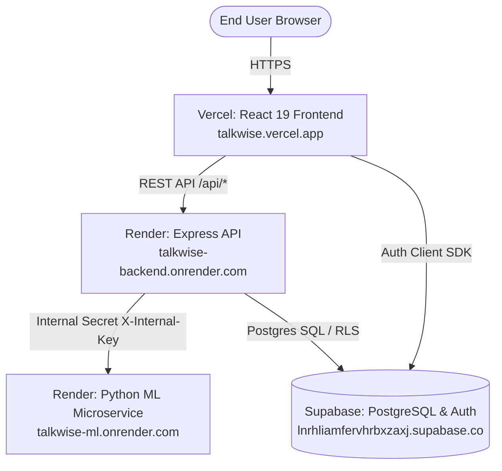

# TalkWise Production Deployment Guide (100% Free-Tier / Zero-Card)

This guide provides instructions to deploy TalkWise to production using only verified zero-cost hosting providers that require **no credit card**:
1. **Frontend:** Vercel (Hobby Free Tier)
2. **Backend Gateway & ML Microservice:** Render (Free Web Service Tier)
3. **Database & Auth:** Supabase (Free Tier PostgreSQL)

---

## 1. Architecture Map

---

## 2. Deploying Python ML Service on Render

1. Sign up / Log in to [Render](https://render.com) (no credit card required).
2. Click **New +** > **Web Service**.
3. Connect your GitHub repository: `springboardmentor620-ai/personalized-ted-talks-recommender`.
4. Configure service:
   - **Name:** `talkwise-ml`
   - **Region:** Oregon (US West) or Frankfurt
   - **Branch:** `student/shivam137421`
   - **Runtime:** `Docker`
   - **Dockerfile Path:** `./Dockerfile.ml`
   - **Instance Type:** `Free` (512 MB RAM, 0.1 CPU)
5. Add Environment Variables:
   - `ML_PORT`: `8000`
   - `ML_INTERNAL_KEY`: `4yr1FDncao9YNu1npB1CfEqDRw2B2q1LZoxpg1jspuA`
6. Click **Create Web Service**. Wait for the build and health check to pass.
7. Copy the public URL (e.g. `https://talkwise-ml.onrender.com`).

---

## 3. Deploying Express Backend on Render

1. Click **New +** > **Web Service** in Render.
2. Select the same GitHub repository.
3. Configure service:
   - **Name:** `talkwise-backend`
   - **Region:** Same region as `talkwise-ml`
   - **Branch:** `student/shivam137421`
   - **Runtime:** `Docker`
   - **Dockerfile Path:** `./Dockerfile.backend`
   - **Instance Type:** `Free`
4. Add Environment Variables:
   - `PORT`: `5000`
   - `NODE_ENV`: `production`
   - `FRONTEND_URL`: `https://talkwise.vercel.app` (or your Vercel URL)
   - `SUPABASE_URL`: `https://lnrhliamfervhrbxzaxj.supabase.co`
   - `SUPABASE_ANON_KEY`: `sb_publishable_GMBnZypQwL7IGrs_JI0KWQ_SmjVBeY_`
   - `SUPABASE_SERVICE_ROLE_KEY`: `<your_service_role_key>`
   - `ML_SERVICE_URL`: `https://talkwise-ml.onrender.com`
   - `ML_INTERNAL_KEY`: `4yr1FDncao9YNu1npB1CfEqDRw2B2q1LZoxpg1jspuA`
5. Click **Create Web Service**.
6. Copy the public URL (e.g. `https://talkwise-backend.onrender.com`).

---

## 4. Deploying React Frontend on Vercel

1. Sign up / Log in to [Vercel](https://vercel.com) (no credit card required).
2. Click **Add New...** > **Project**.
3. Import your GitHub repository.
4. Configure Project Settings:
   - **Framework Preset:** `Vite`
   - **Root Directory:** `frontend`
   - **Build Command:** `npm run build`
   - **Output Directory:** `dist`
5. Add Environment Variables:
   - `VITE_SUPABASE_URL`: `https://lnrhliamfervhrbxzaxj.supabase.co`
   - `VITE_SUPABASE_ANON_KEY`: `sb_publishable_GMBnZypQwL7IGrs_JI0KWQ_SmjVBeY_`
   - `VITE_API_URL`: `https://talkwise-backend.onrender.com/api`
6. Click **Deploy**. Vercel will build and assign a production URL (e.g. `https://talkwise.vercel.app`).
7. Update `FRONTEND_URL` on Render `talkwise-backend` to match your exact Vercel production domain.

---

## 5. Free-Tier Sleeping & Cold-Start Behavior

Render's free tier spins down instances after 15 minutes of inactivity. When a request arrives, cold-starts typically take 45–60 seconds.
- TalkWise handles this gracefully: If the ML service is asleep during a user request, the Express backend automatically serves the **PostgreSQL database popularity fallback**, ensuring users never receive an error screen.
- To prevent sleeping during live evaluation demos, free pinging services (such as [cron-job.org](https://cron-job.org) or [UptimeRobot](https://uptimerobot.com)) can ping `/health` every 10 minutes.

