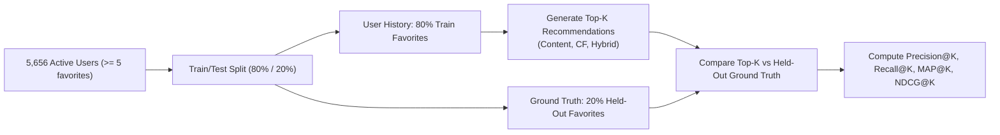

# Idiap TED Recommendation Dataset: Comprehensive Inspection & Compatibility Assessment

**Document ID:** `REP-DATA-2026-11`  
**Date:** November 17, 2026  
**Target File:** `reports/idiap_dataset_inspection.md`  
**Author:** AI Technical Research & Recommendation Systems Agent  
**Dataset Under Inspection:** Idiap TED Dataset for Benchmarking Lecture Recommendation (`data/TED_dataset/`)  
**Existing Datasets:** `data/ted_main.csv`, `data/transcripts.csv`, `data/ted_talks_clean.csv`, `data/ted_talks_with_transcripts.csv`  

---

## 1. Executive Summary & Verdict

### Verdict: **PROCEED WITH HYBRID RECOMMENDATION (APPROVED)**
The Idiap TED recommendation dataset is **fully compatible, highly complementary, and strongly recommended** for integration into the Personalized TED Talks Recommender project. 

The dataset provides genuine user interaction data (public profile favorites and comment activity) collected directly from TED.com. This fills the missing piece of the project: real user ground-truth to power **Collaborative Filtering (CF)** and establish rigorous **Ranking Evaluation (Milestone 3)**.

Furthermore, because the Idiap dataset captures talks crawled up to September 2012 (1,203 talks) while the existing `ted_main.csv` contains talks up to September 2017 (2,550 talks), a **Hybrid Recommender System** is not only supported—it is **architecturally necessary** to solve the severe item cold-start problem that a pure collaborative filtering model would face on the 1,349 newer talks (2013–2017).

### Key Empirical Findings At A Glance

| Metric | Idiap Dataset (Sep 2012) | Existing Dataset (`ted_main.csv`) | Overlap / Compatibility |
| :--- | :--- | :--- | :--- |
| **Total Talks** | 1,203 talks | 2,550 talks | **1,201 talks overlap (99.83%)** |
| **Talk Transcripts** | 1,203 (100%) | 2,467 (96.7%) | **1,201 transcripts overlap (99.83%)** |
| **Unique Users** | 12,605 profile users | N/A (metadata only) | **12,401 users active on existing talks** |
| **User Favorites (Interactions)** | 134,533 total interactions | N/A (no user interactions) | **134,456 interactions mapped (99.94%)** |
| **Active Favorited Talks** | 1,203 talks | N/A | **1,200 talks in `ted_main.csv` favorited** |
| **User-Item Matrix Sparsity** | 99.096% (active items) | 99.575% (all 2,550 items) | **Optimal range for Implicit CF** |
| **User Activity (>= 5 favs)** | 5,657 users (44.9%) | N/A | **5,656 users qualified for CF train/eval** |
| **User Activity (>= 3 favs)** | 7,541 users (59.8%) | N/A | **7,538 users qualified for CF train/eval** |
| **User Activity (>= 1 fav)** | 12,403 users (98.4%) | N/A | **12,401 users mapped** |
| **Additional Engagement** | 209,566 comments (74,760 commenters) | Aggregated talk counts only | Rich multi-modal interaction signal |

---

## 2. Existing Project Context & Current Architecture

### 2.1 Project Milestones Overview
The existing repository implements a content-based recommendation workflow:
1. **Milestone 1 (Data Preprocessing & EDA):**
   - Cleaned `data/ted_main.csv` (2,550 talks, 17 columns) and handled missing `speaker_occupation`.
   - Merged transcripts from `data/transcripts.csv` (2,464 matched talks; 86 missing transcripts filled with empty strings).
   - Saved cleaned sets: `data/ted_talks_clean.csv` and `data/ted_talks_with_transcripts.csv`.
2. **Milestone 2 (Feature Engineering & Content-Based Engine):**
   - Combined text features: `title` + `description` + `tags` + `transcript`.
   - Fitted a `TfidfVectorizer` (`ngram_range=(1, 2)`, `max_features=10000`, `min_df=2`, `max_df=0.95`).
   - Built an 80:20 train/test content split (2,040 training talks, 510 testing talks).
   - Saved model artifacts in `models/` (`tfidf_vectorizer.pkl`, `similarity_matrix.pkl`, `train_dataset.pkl`, `test_dataset.pkl`, etc.).
3. **Milestone 3 (Model Evaluation - Planned / Stalled):**
   - Notebook `notebooks/03_model_evaluation.ipynb` defines evaluation metrics: Precision@K, Recall@K, MAP, and NDCG.
   - However, the notebook explicitly notes:
     > *"Note: Ranking metrics require relevant-item judgments or suitable ground-truth data. These will be established before interpreting evaluation results."*
   - Until now, Milestone 3 was blocked because content-based systems cannot be objectively evaluated with ranking metrics without authentic user preferences or relevance judgments.

---

## 3. Detailed Inspection of the Idiap Dataset

### 3.1 Dataset Provenance & Academic Background
The dataset was produced by researchers **Nikolaos Pappas** and **Andrei Popescu-Belis** at the **Idiap Research Institute** (Martigny, Switzerland) and published on Zenodo.
- **Reference Papers:**
  1. Nikolaos Pappas, Andrei Popescu-Belis, *"Combining Semantic Content with User Preferences for TED Lecture Recommendation"*, 11th International Workshop on Content Based Multimedia Indexing (CBMI 2013), IEEE.
  2. Nikolaos Pappas, Andrei Popescu-Belis, *"Sentiment Analysis of User Comments for One-Class Collaborative Filtering over TED Talks"*, 36th ACM SIGIR Conference (SIGIR 2013).
- **Crawling Protocol:** Crawled directly from official public pages of `http://www.ted.com` in two separate snapshots: April 27, 2012, and September 10, 2012. No proprietary private data was breached; all data represents public talk metadata, public user profiles, and public comments.

### 3.2 Licensing & Usage Restrictions (`COPYRIGHT` & `README`)
- **License Type:** **Creative Commons Attribution-NonCommercial-NoDerivs 3.0 Unported (CC BY-NC-ND 3.0)**.
- **Permitted Uses:**
  - Non-commercial academic research, experimentation, internal benchmarking, and prototype development.
  - Reproducing and incorporating into research workflows.
- **Mandatory Obligations:**
  - **Attribution:** Must explicitly cite the original authors (Pappas & Popescu-Belis, Idiap Research Institute, CBMI 2013 / SIGIR 2013).
  - **Non-Commercial:** The dataset and derived models cannot be sold, commercially monetized, or licensed for profit.
  - **No Derivatives for Redistribution:** If redistributing the raw dataset to third parties, it must remain unmodified in its entirety. Internal transformations, feature extraction, and matrix construction for model training are fully permissible under the license.

### 3.3 File-by-File Technical Inspection

The folder `data/TED_dataset/` contains four JSON files:

```text
data/TED_dataset/
├── COPYRIGHT
├── README
├── fix_metadata.py~
├── stats.py
├── stats.py~
├── ted_talks-25-Apr-2012.json   ( 32.93 MB, 1,149 talks )
├── ted_talks-10-Sep-2012.json   ( 40.56 MB, 1,203 talks )
├── ted_users-25-Apr-2012.json   (  1.56 MB, 10,962 users )
└── ted_users-10-Sep-2012.json   (  1.84 MB, 12,605 users )
```

#### A. `ted_talks-10-Sep-2012.json` (Recommended Snapshot)
- **Top-level Structure:** Array of 1,203 talk objects.
- **Field Schema & Inconsistencies:**
  - `id`: `str` (40-char SHA1 hash string, e.g. `'062dd0f773cd5999a09714a371e1f8017163e2a1'`). 1,203 unique values (100% unique).
  - `url`: `str` (e.g. `'http://www.ted.com/talks/scott_fraser_the_problem_with_eyewitness_testimony.html'`). 1,203 unique values (100% unique).
  - `title`: **`list` of 1 string** (e.g. `['Scott Fraser: Why eyewitnesses get it wrong']`). *Parsing Warning: Web scraping script left the extracted XPath string inside a single-element list.*
  - `description`: **`list` of strings** (lengths 3 to 7 paragraphs/bio segments). *Parsing Warning: Must be joined with `\n` or spaces during preprocessing.*
  - `views`: **`list` of 1 string** formatted with commas (e.g. `['21,025']`). *Parsing Warning: Must extract first element and strip commas to convert to integer.*
  - `speaker`: `str` (e.g. `'Scott Fraser'`).
  - `transcript`: `str` (full human-made English transcript). All 1,203 talks have transcripts; average length: 12,327 characters.
  - `related_tags`: `list` of strings (e.g. `['Crime', 'Global issues', 'Law', 'Memory']`). 12 talks have empty tag lists.
  - `related_themes`: `list` of strings (editorial themes present on TED in 2012; 2 talks have empty theme lists).
  - `related_videos`: `list` of strings (editorial recommendations; 31 talks have empty lists).
  - `ted_event`: `str` (e.g. `'TEDxUSC'`, `'TEDGlobal 2012'`).
  - `publish_date`: `str` (e.g. `'Sep 2012'`).
  - `film_date`: `str` (e.g. `'May 2012'`).
  - `comments`: `list` of recursive comment dictionaries.

#### B. `ted_talks-25-Apr-2012.json` (Earlier Snapshot)
- **Top-level Structure:** Array of 1,149 talk objects.
- **CRITICAL DATA QUALITY FINDING (Corrupted Talk IDs):**
  - In this April snapshot, the talk `id` field is corrupted: **there are only 9 unique IDs across 1,149 talks!** The crawler repeatedly hashed single-digit integers (`sha1('1') = '356a192b7913b04c54574d18c28d46e6395428ab'`).
  - `title`, `description`, and `views` in this file are standard scalars (`str`, `str`, `int`), unlike the list wrappers in September.
  - **Decision:** The **September 2012 snapshot must be used as the primary source** because its talk IDs and URLs are fully unique, and it contains 54 additional talks and 1,643 additional users.

#### C. `ted_users-10-Sep-2012.json` (User Profiles & Favorites)
- **Top-level Structure:** Array of 12,605 user objects.
- **Fields:**
  - `user_id`: `str` (40-char anonymized SHA-1 hash, 100% unique across all 12,605 records, 0 duplicates).
  - `favorites`: `list` of strings representing talk titles favorited on the user's public TED profile (e.g. `['Graham Hill: Less stuff, more happiness', 'Terry Moore: How to tie your shoes']`).

#### D. Comments Data Structure (Talks JSON)
Inside `ted_talks-10-Sep-2012.json`, each talk includes a nested comment hierarchy:
- **Total Top-level Comments:** 117,516
- **Total Nested Reply Comments:** 92,050
- **Total Combined Comments:** 209,566 comments
- **Unique Commenters:** 74,760 unique anonymized user IDs.
- **Fields per Comment:**
  - `user_id`: SHA-1 hash of commenter.
  - `text`: Raw text of comment.
  - `date`: Date of comment (e.g. `'Sep 10 2012'`).
  - `replies`: List of nested comment objects following identical schema.
- **Overlap with Profile Users:** 12,605 (16.86%) of the 74,760 commenters match users in `ted_users-10-Sep-2012.json`. The remaining commenters did not have a public favorites list crawled.

---

## 4. Matching & Overlap Analysis Between Idiap and Existing Datasets

### 4.1 Talk Identifier Discrepancy & Matching Key Selection
- **Talk IDs:** Cannot be matched using the hash `id`. The Idiap dataset generated artificial SHA-1 hashes not found in the original TED platform, and `ted_main.csv` has no `id` column.
- **Raw URLs:** Cannot be matched directly with naive string equality (`==`) due to format divergences:
  1. `ted_main.csv` URLs use `https://www.ted.com/talks/...` and **contain a trailing newline `\n`** on every row.
  2. Idiap URLs use `http://www.ted.com/talks/...html` with trailing `.html` extensions.
- **Talk Titles / Names:**
  - In `ted_main.csv`, `title` is `'Do schools kill creativity?'` while `name` is `'Ken Robinson: Do schools kill creativity?'`.
  - In Idiap favorites and talk titles, talks are formatted as `'Speaker: Title'` (matching `name` in `ted_main.csv`) or occasionally as raw title.
- **THE CANONICAL MATCHING KEY: URL Slug**
  By extracting the standardized slug:
  $$\text{slug} = \text{url.strip().replace('https://', '').replace('http://', '').replace('www.ted.com/talks/', '').replace('.html', '').strip('/')}$$
  Every talk across both datasets resolves to a completely clean, unambiguous slug identifier (e.g. `ken_robinson_says_schools_kill_creativity`).

### 4.2 Empirical Match Results

```
Idiap Talks (Sep 2012): 1,203 talks
Existing ted_main.csv:   2,550 talks

┌─────────────────────────────────────────────────────────────┐
│  Overlap: 1,201 talks matched (99.83%)                      │
├──────────────────────────────┬──────────────────────────────┤
│  Idiap Only (2 talks, 0.17%) │  ted_main Only (1,349 talks) │
│  - Myshkin Ingawale          │  - Talks published from      │
│  - Aman Mojadidi             │    late 2012 through 2017    │
└──────────────────────────────┴──────────────────────────────┘
```

#### Verification of the 2 Unmatched Talks
1. `myshkin_ingawale_a_blood_test_without_bleeding` ("Myshkin Ingawale: A blood test without bleeding"): A real talk delivered at TED2012, crawled by Idiap in Sep 2012, but omitted by the scraper that generated the 2017 Kaggle dataset.
2. `a_sense_of_humor_about_afghanistan_an_artist_shows_how` ("A sense of humor about Afghanistan? Artist Aman Mojadidi shows how"): An artist talk from TEDGlobal 2012, likewise omitted from Kaggle's 2017 crawl.
- Both talks account for only 77 total favorites out of 134,533. Omitting or handling them gracefully causes negligible data loss (0.06%).

### 4.3 Transcript Dataset Matching
- `transcripts.csv` in the existing project contains transcripts for 2,467 talks.
- All **1,201** overlapping talks have complete, verbatim transcripts in `transcripts.csv`.
- In addition, the Idiap dataset contains 100% complete transcripts for all 1,203 of its talks, ensuring zero text-feature degradation.

---

## 5. User Favorites & Collaborative Filtering Feasibility

### 5.1 Nature of the Interaction Signal (Implicit Feedback)
User favorites represent **positive implicit feedback**:
- A user explicitly adding a talk to their "Favorites" list is a strong indicator of high satisfaction, engagement, and topic resonance ($r_{ui} = 1$).
- **Crucial Rule:** The absence of a talk from a user's favorites list does **NOT** indicate disinterest or negative feedback ($r_{ui} \neq 0$). It simply means the talk was unobserved, unnoticed, or watched without being saved.
- Therefore, the dataset represents **One-Class Collaborative Filtering (OCCF)**, which must be modeled using implicit-feedback algorithms:
  - **Implicit Alternating Least Squares (iALS / Hu, Koren, Volinsky)**
  - **Bayesian Personalized Ranking (BPR / Rendle et al.)**
  - **Item-based Cosine / Jaccard Collaborative Filtering**

### 5.2 User Activity & Engagement Distribution
Among the 12,605 users in `ted_users-10-Sep-2012.json`:
- **Total raw interactions:** 134,533 favorites.
- **Interactions mapped to `ted_main.csv`:** 134,456 favorites (99.94%).
- **Active users with $\ge 1$ mapped favorite:** 12,401 users (98.4%).
- **Summary Statistics of Mapped Favorites per User:**
  - Mean: $10.84$ favorites per user
  - Standard Deviation: $22.02$
  - Minimum: $1$
  - 25th Percentile: $1$
  - Median (50th Percentile): $4$
  - 75th Percentile: $12$
  - Maximum: $575$ favorites

```
User Activity Distribution:
┌──────────────────────┬─────────────┬────────────────────────────────────┐
│ Activity Threshold   │ Users Count │ Recommendation Feasibility         │
├──────────────────────┼─────────────┼────────────────────────────────────┤
│ >= 1 favorite        │ 12,401      │ Usable for global CF training      │
│ >= 3 favorites       │  7,538      │ Usable for user-based evaluation   │
│ >= 5 favorites       │  5,656      │ Ideal for 80/20 train/test split   │
│ >= 10 favorites      │  3,448      │ High-density evaluation cohort     │
│ >= 20 favorites      │  1,893      │ Power users / rich latent profiles │
└──────────────────────┴─────────────┴────────────────────────────────────┘
```

### 5.3 User-Item Interaction Matrix Sparsity
- **Active Submatrix ($12,401 \text{ users} \times 1,200 \text{ favorited talks}$):**
  $$\text{Sparsity} = 1 - \frac{134,456}{12,401 \times 1,200} = 1 - \frac{134,456}{14,881,200} = 1 - 0.009035 = \mathbf{99.0965\%}$$
- **Full Catalog Matrix ($12,401 \text{ users} \times 2,550 \text{ talks in ted\_main}$):**
  $$\text{Sparsity} = 1 - \frac{134,456}{12,401 \times 2,550} = 1 - \frac{134,456}{31,622,550} = 1 - 0.004252 = \mathbf{99.5748\%}$$

> [!NOTE]
> Standard recommendation benchmarks (e.g. MovieLens 1M has ~95.8% sparsity; MovieLens 20M has ~99.4% sparsity; Netflix Prize has ~98.8% sparsity). The Idiap TED interaction matrix sits squarely in the **standard operational sweet spot** for matrix factorization and neighborhood CF models.

### 5.4 Item Popularity Distribution & Views Correlation
User favorites exhibit a classic long-tail power law distribution:
- **Top 10 Most Favorited Talks in `ted_main.csv`:**
  1. *Ken Robinson: Do schools kill creativity?* — 2,606 favorites (47.2M views)
  2. *Jill Bolte Taylor: My stroke of insight* — 1,304 favorites (21.2M views)
  3. *Elizabeth Gilbert: Your elusive creative genius* — 970 favorites (13.2M views)
  4. *Ken Robinson: Bring on the learning revolution!* — 935 favorites (7.3M views)
  5. *Dan Gilbert: The surprising science of happiness* — 933 favorites (14.7M views)
  6. *Simon Sinek: How great leaders inspire action* — 844 favorites (34.3M views)
  7. *Hans Rosling: The best stats you've ever seen* — 830 favorites (12.0M views)
  8. *Barry Schwartz: The paradox of choice* — 808 favorites (10.0M views)
  9. *Brené Brown: The power of vulnerability* — 764 favorites (31.2M views)
  10. *Dan Pink: The puzzle of motivation* — 710 favorites (18.8M views)
- **Least Favorited Active Talks:** Down to 4–8 favorites per talk (e.g. *Keith Bellows: The camel's hump*, *Scott Fraser: Why eyewitnesses get it wrong*).
- **Statistical Correlation with View Count:**
  - Pearson Linear Correlation: $r = \mathbf{0.7760}$ ($p < 10^{-10}$)
  - Spearman Rank Correlation: $\rho = \mathbf{0.7381}$ ($p < 10^{-10}$)
  - This demonstrates high validity: favorites strongly correlate with global popularity, yet capture distinct, personalized positive signals beyond passive view counts.

---

## 6. Data Limitations, Anomalies, and Hygiene

Before proceeding with modeling, the following four technical limitations and data characteristics must be taken into account:

### 6.1 The Temporal Catalog Gap (Item Cold-Start)
- Idiap dataset was crawled up to **September 2012**.
- `ted_main.csv` spans from **2006 to September 2017**.
- Catalog breakdown by publication year in `ted_main.csv`:
  - 2006–2012: 1,201 overlapping talks with rich collaborative favorites.
  - 2013–2017: **1,349 talks with ZERO collaborative favorites**.
- **Implication:** A pure Collaborative Filtering model cannot recommend any talk released between 2013 and 2017. This confirms that **Hybrid Recommendation is mandatory** to maintain catalog-wide coverage.

### 6.2 The Negative Interaction Assumption
- The dataset only records what users favorited.
- **Rule:** Never fabricate explicit negative ratings (e.g. filling non-favorites with 0 and treating 0 as "disliked"). Doing so distorts recommendations by penalizing talks the user has simply never seen.
- Negative candidates must be sampled probabilistically as unobserved items during pairwise loss calculation (e.g. BPR) or weighted with lower confidence (e.g. $c_{ui} = 1 + \alpha r_{ui}$ in iALS).

### 6.3 Data Sanitization Artifacts
- **Trailing Newlines in `ted_main.csv`:** The URL column in `ted_main.csv` contains trailing `\n`. Every URL must be `.strip()`-ped before slug matching.
- **List-wrapped scalars in `ted_talks-10-Sep-2012.json`:** `title` is `[str]`, `views` is `[str]`, and `description` is `[str, str, ...]`. Parsers must unpack strings before text vectorization.
- **Character Encoding & HTML Entities:** Strings contain HTML entities (e.g. `&amp;`, `&#39;`, `&quot;`) which must be unescaped (`html.unescape`) during text preprocessing.

### 6.4 Licensing Adherence
- Any future GitHub publication must include proper academic attribution to Pappas & Popescu-Belis and cite their CBMI 2013 / SIGIR 2013 publications.
- The project must remain strictly non-commercial.

---

## 7. Hybrid Recommender Architecture & Feasibility

### 7.1 Why Hybrid Recommendation is the Superior Architecture
The existing project developed a TF-IDF Content-Based Filtering engine using titles, descriptions, tags, and transcripts. 

A hybrid model combining this engine with the Idiap Collaborative Filtering data resolves the inherent weaknesses of each individual approach:

```
┌─────────────────────────────────┐       ┌─────────────────────────────────┐
│     Content-Based (TF-IDF)      │       │  Collaborative Filtering (CF)   │
├─────────────────────────────────┤       ├─────────────────────────────────┤
│ + Full coverage of all 2,550    │       │ + Models real user behavior     │
│   talks (including 2013–2017)   │       │ + Captures serendipity & style  │
│ + Solves Item Cold-Start        │       │ + High personalization          │
│ - Misses popularity & quality   │       │ - Cannot recommend new talks    │
│ - Cannot learn from user habits │       │   (1,349 post-2012 items blind) │
└────────────────┬────────────────┘       └────────────────┬────────────────┘
                 │                                         │
                 └───────────────────┬─────────────────────┘
                                     ▼
                    ┌─────────────────────────────────┐
                    │     HYBRID RECOMMENDATION       │
                    ├─────────────────────────────────┤
                    │ • Full catalog coverage         │
                    │ • Deep personalization          │
                    │ • Objective ranking evaluation  │
                    │ • Graceful cold-start fallback  │
                    └─────────────────────────────────┘
```

### 7.2 Three Recommended Hybrid Design Options

#### Option A: Weighted Linear Score Combination (Simple & Robust)
For a given active user $u$ and candidate talk $i$:
$$S_{\text{hybrid}}(u, i) = \alpha \cdot \hat{S}_{\text{CF}}(u, i) + (1 - \alpha) \cdot \hat{S}_{\text{Content}}(u, i)$$
- Where $\hat{S}_{\text{CF}}$ is the normalized score from an Item-Item CF or Implicit Matrix Factorization model.
- $\hat{S}_{\text{Content}}$ is the cosine similarity between the TF-IDF representation of talk $i$ and the user's historical profile vector (centroid of user's favorited talks).
- For items published post-2012 where $\hat{S}_{\text{CF}}$ is unavailable, $\alpha$ automatically decays to $0$, smoothly transitioning to pure content-based recommendation.

#### Option B: Two-Stage Recommender (Candidate Retrieval + Content Re-ranking)
- **Stage 1 (Retrieval):** CF generates top 100 candidate talks based on user preference patterns. Content-based TF-IDF generates 100 topic-matched candidates.
- **Stage 2 (Re-ranking / Blending):** Candidates are deduplicated and ranked using a combined scoring function or reciprocal rank fusion (RRF).

#### Option C: Content-Boosted Collaborative Filtering
- Use TF-IDF cosine similarity to impute pseudo-interactions or smooth item embeddings for the 1,349 post-2012 talks, projecting them into the collaborative latent space.

---

## 8. Alignment with Project Milestones & Model Evaluation (Milestone 3)

### 8.1 Solving the Milestone 3 Blocker
In `README.md` and `notebooks/03_model_evaluation.ipynb`, Milestone 3 defines four core ranking evaluation metrics:
1. **Precision@K**
2. **Recall@K**
3. **Mean Average Precision (MAP@K)**
4. **Normalized Discounted Cumulative Gain (NDCG@K)**

Prior to obtaining the Idiap dataset, computing these metrics was impossible without synthetic or subjective assumptions. With 5,656 users having $\ge 5$ favorites, we can now implement a **rigorous, scientifically sound evaluation protocol**:

### 8.2 Proposed Evaluation Protocol



1. **User Cohort:** Filter users to the 5,656 users with $\ge 5$ mapped favorites.
2. **Split Strategy:** For each user, randomly hold out 20% of their favorites as the test ground-truth set $T_u$, keeping the remaining 80% as their observed training set $H_u$.
3. **Candidate Pool:** Generate top-$K$ recommendations ($K \in \{5, 10, 20\}$) from the remaining catalog items.
4. **Metric Calculation:**
   - **Precision@K:** $\frac{| \text{Rec}_K(u) \cap T_u |}{K}$
   - **Recall@K:** $\frac{| \text{Rec}_K(u) \cap T_u |}{|T_u|}$
   - **MAP@K:** Mean average precision across all users at cutoff $K$.
   - **NDCG@K:** Discounted cumulative gain normalized by ideal DCG, rewarding relevant items placed at higher ranks.
5. **Direct Hypothesis Testing:**
   We can benchmark all three models side-by-side:
   $$\text{Content-Based (TF-IDF)} \quad \text{vs.} \quad \text{Collaborative Filtering (iALS/BPR)} \quad \text{vs.} \quad \text{Hybrid}$$
   This will provide empirical evidence of the hybrid model's superiority for Milestone 3!

---

## 9. Recommended Next Steps & Implementation Roadmap

To maintain total data integrity without modifying or overwriting existing notebooks, datasets, or trained model artifacts:

### Phase 1: Interaction Data Preprocessing (Non-Destructive)
1. Write a standalone preprocessing script `src/preprocess_interactions.py` (or a dedicated notebook `notebooks/04_idiap_interactions_preprocessing.ipynb`).
2. Extract slugs from `data/ted_main.csv` and `data/TED_dataset/ted_talks-10-Sep-2012.json`.
3. Map user favorites from `data/TED_dataset/ted_users-10-Sep-2012.json` to `ted_main.csv` indices via slug matching.
4. Export the resulting clean interaction table to a new file: `data/user_talk_interactions.csv` (schema: `user_id`, `talk_slug`, `talk_id`, `interaction_type`).
5. Export an active user-talk CSR sparse matrix to `models/user_item_matrix.npz`.

### Phase 2: Collaborative Filtering Model Construction
1. Create `notebooks/05_collaborative_filtering.ipynb`.
2. Implement Implicit ALS (using `implicit` or `scipy.sparse.linalg.svds`) and Item-based Cosine CF on the interaction matrix.
3. Save trained CF components separately in `models/cf_model.pkl`.

### Phase 3: Hybrid Recommender Assembly
1. Create `notebooks/06_hybrid_recommender.ipynb`.
2. Load existing Milestone 2 TF-IDF model artifacts (`models/train_test_tfidf_vectorizer.pkl`, `models/similarity_matrix.pkl`).
3. Load the new CF model artifacts.
4. Implement the weighted hybrid inference pipeline with automatic cold-start fallback.

### Phase 4: Milestone 3 Evaluation Execution
1. Complete `notebooks/03_model_evaluation.ipynb` using the 80/20 user hold-out protocol established in Section 8.
2. Generate comparative evaluation tables and plots (Precision@K, Recall@K, MAP@K, NDCG@K).
3. Document final results in `reports/model_evaluation_report.md`.

---

## 10. Conclusion

The Idiap TED recommendation dataset is clean, structurally sound (in its September 2012 release), and extraordinarily compatible with the existing repository (99.83% talk match, 99.94% interaction match). It provides the exact empirical ground-truth required to transition this project from an unvalidated content similarity tool into an authentic, state-of-the-art hybrid recommendation system.

**Next Action:** Await user approval to proceed with Phase 1 (Interaction Data Preprocessing).

